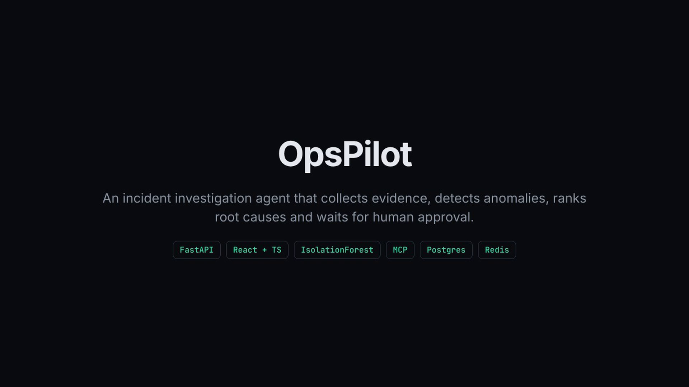

# OpsPilot V3: Evidence-grounded incident investigation

OpsPilot is a portfolio-grade incident investigation system that collects telemetry evidence, runs an **IsolationForest** anomaly detector, retrieves operational runbooks, ranks root-cause hypotheses, traces the investigation, and keeps remediation behind explicit human approval.

## Demo

[](https://github.com/kalpshah2600/opspilot/raw/main/docs/demo/opspilot-demo.mp4)

[Watch or download the 58-second demo (MP4, 1080p)](https://github.com/kalpshah2600/opspilot/raw/main/docs/demo/opspilot-demo.mp4): injecting a database pool exhaustion and a Kafka consumer lag incident, reviewing ranked hypotheses and evidence, and approving the proposed remediation.

It has two reasoning modes:

- `rules` (default): deterministic, free, reproducible baseline.
- `openai`: a **real optional OpenAI structured-output adapter** that receives metrics, anomaly output, logs, deployments, retrieved evidence and baseline hypotheses, then returns a constrained diagnosis. If the provider fails, OpsPilot logs the failure and falls back to the deterministic baseline.

The project intentionally does **not** claim that an LLM is required for incident response. The point is to compare a transparent baseline with an LLM-assisted reasoning path on the same evidence.

## What is actually implemented

- FastAPI API and React + TypeScript UI
- Evidence collection from metrics, logs and deployment history
- scikit-learn `IsolationForest` invoked on every investigation
- lexical runbook retrieval with evidence grounding
- deterministic hypothesis baseline that requires cause-specific evidence, abstains on ambiguous or unsupported cases, and flags anomalies the diagnosis cannot explain
- a verification step that applies the same evidence rules to the LLM's choice
- optional OpenAI structured-output hypothesis ranker
- a real MCP server over stdio (`python -m app.mcp_server`) exposing metrics, log search, deployments and runbook search
- PostgreSQL persistence for investigations/approvals when `DATABASE_URL` is configured
- Redis incident/approval cache when `REDIS_URL` is configured
- structured JSON application logs
- human approval records; the portfolio environment intentionally executes **no production mutation**
- Docker Compose for API, UI, PostgreSQL and Redis
- GitHub Actions for backend tests/benchmark and frontend production build

## Run locally

### Docker Compose
```bash
docker compose up --build
```
Open `http://localhost:5173`.

### Python only
```bash
python -m venv .venv
source .venv/bin/activate
pip install -r requirements.txt
PYTHONPATH=. uvicorn app.main:app --reload
```

### Frontend
```bash
cd frontend
npm ci
npm run dev
# production verification
npm run build
```

## LLM reasoning (optional)
The default works without any API key.

```bash
export OPSPILOT_REASONER=openai
export OPENAI_API_KEY=...
export OPSPILOT_LLM_MODEL=gpt-4o-mini
PYTHONPATH=. uvicorn app.main:app --reload
```

`app/reasoners.py` contains the provider call and strict JSON schema. The API response reports which reasoner actually produced the diagnosis.

## MCP
Run the MCP server over stdio:
```bash
PYTHONPATH=. python -m app.mcp_server
```
Tools: `get_metrics`, `search_logs`, `get_deployments`, `search_runbooks`.

## Evaluation
```bash
PYTHONPATH=. python evaluation/benchmark.py --check
```
133 synthetic cases generated deterministically by `evaluation/cases.py`. The benchmark scores the current rules and the previous (V3) rules on the same cases, so the effect of each change is visible.

| Category | Cases | Current | V3 rules |
|---|---:|---:|---:|
| Known failures diagnosed correctly | 60 | 100% | 100% |
| Near misses (shared symptom or keyword, different cause): abstained | 20 | 100% | 10% |
| Unseen failure types: abstained | 18 | 100% | 100% |
| Two simultaneous failures: abstained | 5 | 100% | 0% |
| Correct diagnosis with an unexplained anomaly flagged | 5 | 100% | 0% |
| Healthy telemetry: no incident reported | 10 | 100% | 100% |
| Edge cases chosen to expose limits | 15 | 0% | 67% |
| False abstentions on known failures (lower is better) | 60 | 0% | 0% |

How to read this:

- The 100% rows mostly show that the rules match cases written by the same author. They are regression checks, not evidence of general accuracy.
- The near-miss and compound rows are the meaningful change: V3 forced a thread-pool exhaustion into "database pool exhaustion" because both logs contain the word "pool"; the current rules require cause-specific evidence and abstain.
- The edge-case row shows the cost. Stricter rules abstain on real incidents that sit just under a threshold (Postgres at 85 to 89% connections, Kafka lag under 10,000), and they still misdiagnose lock contention that also fills the connection pool. These cases are reported, not hidden, and are not part of the CI thresholds.

CI fails if any thresholded category drops below its minimum (see `THRESHOLDS` in `evaluation/benchmark.py`). This is a controlled synthetic benchmark, not production accuracy.

## Tests
```bash
PYTHONPATH=. pytest -q
```

## Architecture
```text
React/TypeScript -> FastAPI -> evidence collector
                              |-> IsolationForest
                              |-> logs / metrics / deployments
                              |-> runbook retrieval
                              |-> rules baseline
                              `-> optional OpenAI structured reasoner
                                      |
                               diagnosis + alternatives
                                      |
                               human approval boundary
                                      |
                              PostgreSQL + Redis

MCP stdio server -> metrics / logs / deployments / runbooks
```

See [docs/ARCHITECTURE.md](docs/ARCHITECTURE.md) for the investigation flow, reasoners and design decisions.

## Honest limitations
- The included telemetry is synthetic; this is not connected to a real production environment.
- Runbook retrieval is lexical, not vector/embedding retrieval.
- The deterministic baseline explicitly knows three demo incident families, and its fixed thresholds miss incidents that sit just below them (see the edge cases above).
- The OpenAI path requires the user's API key and is not exercised by CI.
- PostgreSQL/Redis are optional infrastructure paths; Python-only development can run without them.
- Approval is recorded, but remediation is deliberately not executed.

These constraints are intentional and documented so the repository can be evaluated on what the code actually does.
