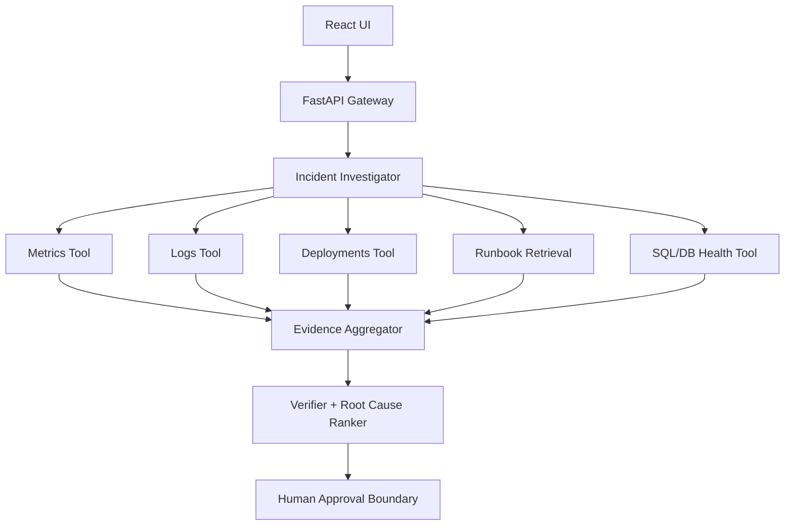

# OpsPilot — AI Production Incident Engineer

OpsPilot is a portfolio-grade incident investigation system. It combines deterministic observability tools, retrieval, anomaly detection, and an optional LLM reasoning layer to investigate failures in a small distributed commerce application.

## What it demonstrates
- FastAPI APIs and tool-oriented agent architecture
- React + TypeScript incident investigation UI
- PostgreSQL/Redis-ready architecture with local zero-dependency fallback
- Metrics/log/deployment/runbook retrieval with evidence citations
- ML anomaly detection (Isolation Forest when scikit-learn is available; robust z-score fallback)
- Reproducible incident benchmark and evaluation metrics
- Human approval boundary for remediation actions
- Docker, CI, tests, structured logging, health checks

## Demo scenario
Run the stack, inject a `db_pool_exhaustion` incident, then ask OpsPilot to investigate. It correlates elevated latency/error rate, DB saturation, a recent deployment, logs, and a runbook before returning a ranked root cause and remediation proposal.

## Quick start (local)
```bash
python3 -m venv .venv
source .venv/bin/activate
pip install -r requirements.txt
uvicorn app.main:app --reload --port 8000
```
In another terminal:
```bash
curl -X POST http://localhost:8000/demo/reset
curl -X POST http://localhost:8000/demo/incidents/db_pool_exhaustion
curl -X POST http://localhost:8000/investigate -H 'Content-Type: application/json' -d '{"question":"Why did checkout failures increase?"}'
```
Open API docs at `http://localhost:8000/docs`.

## Frontend
```bash
cd frontend
npm install
npm run dev
```
The UI expects the API at `http://localhost:8000` by default.

## Docker
```bash
docker compose up --build
```
Then visit `http://localhost:5173`.

## Optional LLM
The default investigator is deterministic so the repository works without paid APIs. Set `OPENAI_API_KEY` and `OPSPILOT_LLM=1` to enable the optional OpenAI-compatible reasoning adapter. Tool evidence remains the source of truth.

## Architecture


## Evaluation
The benchmark in `evaluation/incidents.json` contains labeled incidents. Run:
```bash
python evaluation/run_benchmark.py
```
It reports root-cause accuracy, evidence coverage, mean investigation latency, and unsafe-action rate. Do not put benchmark numbers on your resume until you have actually run and recorded them.

## Repository map
- `app/` API, investigator, tools, retrieval, demo telemetry
- `ml/` anomaly detector
- `evaluation/` labeled benchmark + runner
- `frontend/` React/TypeScript UI
- `tests/` API and investigator tests
- `.github/workflows/` CI
- `docs/` architecture and interview talking points

## Safety design
OpsPilot never executes remediation from the investigation endpoint. It proposes an action and requires an explicit approval call. The included approval endpoint is a demo boundary and records the action; production integrations should add authentication, RBAC, audit logs, policy checks, and deployment-provider controls.

## Portfolio positioning
This project is intentionally built around measurable engineering behavior rather than a generic chatbot: tool use, evidence grounding, evaluation, observability, failure injection, and human-in-the-loop remediation.


## V2: evidence-first agent

V2 removes the ground-truth shortcut from the investigator. The diagnostic layer sees only observable metrics, logs and deployment history. It ranks competing hypotheses, retrieves relevant runbooks, returns an evidence trail, and places remediation behind explicit human approval.

Additional V2 endpoints:

- `GET /tools` — MCP-compatible tool contracts
- `GET /observability` — agent span call/latency summaries
- `POST /approve` — records human approval; performs **no production mutation**

### Reproducible V2 benchmark

```bash
python evaluation/generate_dataset.py
python evaluation/run_benchmark_v2.py
```

Current checked result on the included deterministic synthetic suite: **60/60 root-cause classifications**, **100% runbook grounding**, **0 autonomous remediation actions**. These are synthetic test results across three included failure families, not a claim of real-world production accuracy.

### Verification

```bash
PYTHONPATH=. pytest -q
```

Current repository status: **7 tests passing**.

See `docs/V2_DESIGN.md` for design and evaluation limitations.
